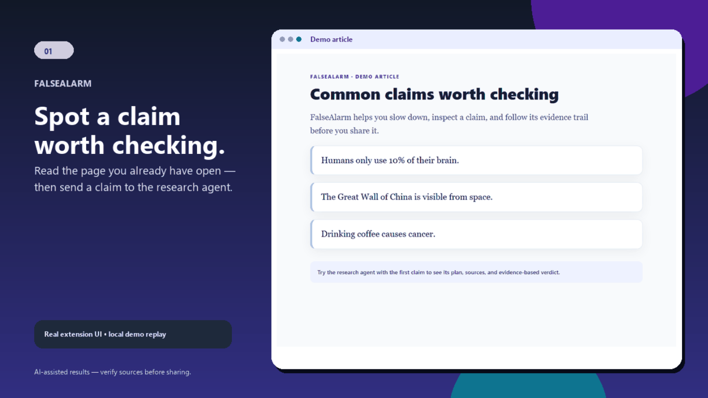
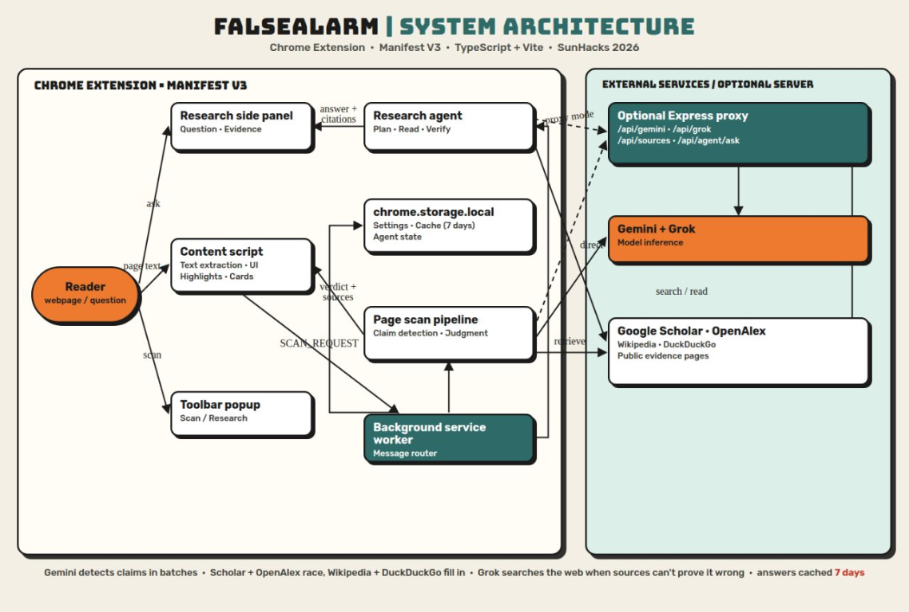
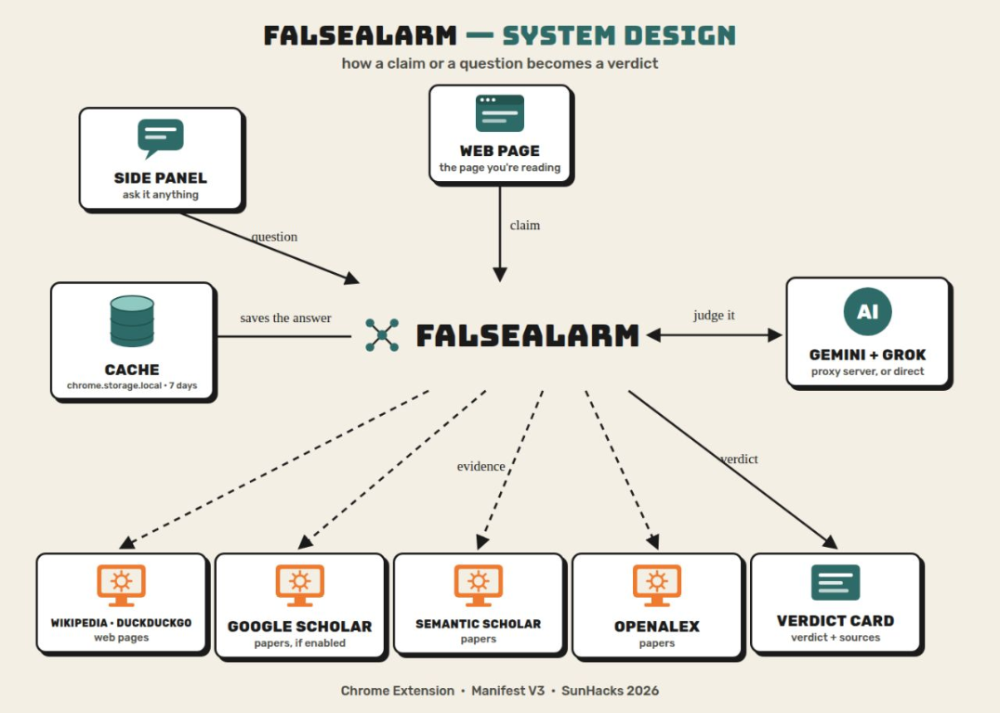

# falsealaram

falsealaram is a Chrome Manifest V3 extension that highlights questionable factual
claims on webpages and links readers to scholarly sources. Results are
AI-assisted; verify the cited material before sharing.

## Build and install

```powershell
npm install
npm run build
```

In Chrome, open `chrome://extensions`, enable Developer mode, select **Load
unpacked**, and choose the generated `dist` folder.

## Demo



Open `test/demo.html` (or `dist/demo-test-page.html` after building), open the
FalseAlarm toolbar popup, and select **Scan this page**. The resulting
**Flagged on this page** list jumps to each false, misleading, or unsure claim.
Direct page scans require Gemini and Grok API keys in Options; alternatively,
configure and start the proxy server. Check the linked sources before relying on
any result.

## Architecture

### System architecture



### System design



## Research agent

The toolbar popup also opens a side-panel research agent for a factual question.
It plans searches, uses the same Scholar/OpenAlex→Wikipedia/DuckDuckGo fallback
policy as page scans, reads the public source pages, verifies quoted evidence, and
returns an evidence-based finding. Direct research needs Gemini; Grok is used for
the final screening when configured and Gemini is the fallback otherwise.

## API modes

- **Direct** page scans require Gemini and Grok API keys, stored in the
  browser's `chrome.storage.local`. The research agent can run with Gemini only.
- **Proxy** sends model requests to the configured Node server. Keep API keys
  on the server in environment variables; never commit them.
- Source search uses Google Scholar when enabled, then OpenAlex. Wikipedia and
  DuckDuckGo results are used as fallbacks; Google Scholar scraping is best-effort
  and can be blocked.

For the local proxy, copy `proxy/.env.example` to `.env` in the project root,
then set `GEMINI_API_KEY` (or the legacy `gemini_token`), plus optionally
`GROK_API_KEY`, `OPENALEX_API_KEY`, and `PROXY_TOKEN` before running:

```powershell
npm run proxy
```

The extension's proxy URL defaults to `http://localhost:8787`. Start the proxy
before selecting Proxy mode, and use the same proxy token in the server
environment and falsealaram Options when configured.

## Safety and limits

- The claim limit is configurable (default 12, maximum 20).
- Retired built-in model defaults are upgraded automatically; custom model names
  are retained.
- Banking, email, login/account/checkout pages, password-field pages, and
  incognito contexts are skipped.
- Claim results are cached locally for seven days.
- The extension extracts visible text blocks only; it does not edit page text.
